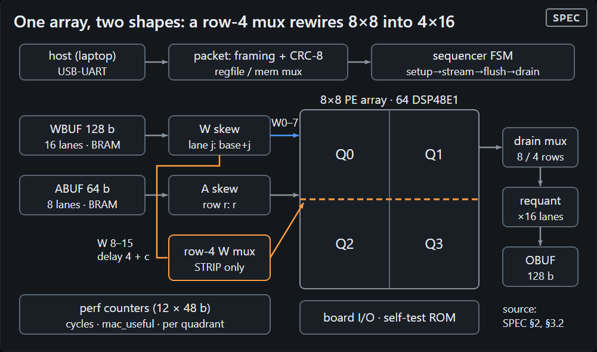

# SplitSys: a splittable int8 systolic array for LLM matmuls, on a Spartan-7 FPGA

<!--
HONESTY KEY (red-team: audit every number in this file against this key).
  [M]  MODEL  results/model/sweep.json + roofline.json, model_git_hash 72da65248adf
              (latencies confirmed by RTL, D-017). Values also in results/plots/manifest.json.
  [SIM] SIM   results/sim/*.json (top level only; never results/sim/archive_dirty/): 70 per-run records
              (results/sim/session.json: gemms_run 70, macs_verified 17,014,784, mismatches 0), from two
              clean builds of the same RTL (git diff f402cc7 5900507 -- rtl spec is empty):
                66 at build_id 0f402cc7 / git f402cc7, committed e2cea28 (56-run bench sweep + 10 cosim-check);
                 4 at build_id 05900507 / git 5900507, committed fb89e37 (scripted demo: ffn_up M=1,64 x2 modes).
              model_git_hash 72da65248adf on all 70. 58 distinct shape/mode/requant combinations;
              2 records are int32 bypass (requant off). Verilator co-sim of the real top, driven through
              its UART pins by the real splitsys-host. Every record: golden_match, 0 mismatches,
              invariants_ok, all 12 counters == model, cycles_stall 0; 217,088 outputs compared in total.
              SIM is NOT hardware.
  [B]  BUILD  results/cost.json (source "hw-build"), committed 23acf6a: S4 freeze rebuild at git 38a3950a,
              build_id 0x38A3950A for both builds, Vivado 2025.2.1 post-route. The split build is the KG2 bitstream
              (fpga/known_good/KG2/summary.json: build_id 0x38A3950A, lut 7389, ff 7936, dsp 96, bram 26, wns 0.744).
              Datapath RTL identical to the SIM builds: git diff f402cc7 52a66216 -- rtl spec is empty;
              git diff 52a66216 38a3950a -- rtl spec touches only rtl/top.sv + rtl/board_io.sv
              (LEFT_IS_D1, AN0_IS_RIGHT display defaults and comments). The RGB PULLDOWN is an XDC change.
  [V]  VERIF  tb/SIGNOFF.md (11/11 suites, 64/64 tests, eligible run at b53783d),
              tb/system/SIGNOFF_SYSTEM.md (617/617, eligible, head f402cc7), docs/DECISIONS.md D-016/D-017.
              Live-bitstream RTL (KG2, last rtl/ commit dc1dea0; git diff dc1dea0 38a3950a -- rtl spec is empty),
              signed off in commit 9ec73e1: tb/SIGNOFF.md "Sign-off for KG2 candidate RTL dc1dea0" (11/11 suites,
              64/64 tests, eligible YES, run 20261024-134407-25872 at head 7b3af2c; also 11/11 64/64 at head dc1dea0)
              and tb/system/SIGNOFF_SYSTEM.md (625/625 = the previous 617 + display 8/8, eligible YES, head bee1cec).
  [HW] HW     results/hw/*.json (top level, source "hw"): 473 per-run records on the board (COM3), host git 3976ec0,
              model_git_hash 72da65248adf on all 473, from two bitstreams with the same datapath RTL (see [B]):
              KG1, build_id 52a66216 (fpga/known_good/KG1, bit_md5 6a85a822b28e7d9f2097a8a902d865bf): 272 records
                200 from H-5 `run --random 100 --mode both --seed 1` (100 FULL + 100 STRIP, up to M/K/N 64/256/256,
                    17 of them int32 bypass), committed e180386, log results/hw/logs/H-5_random_both_seed1.log;
                 56 from H-6 `bench sweep --seed 1` (4 GEMMs x M 1..64 x FULL/STRIP), committed 2bacace,
                    summary results/hw/bench_sweep_2026-10-24T20-41-07Z.json, log results/hw/logs/H-6_bench_sweep_seed1.log;
                 16 from H-7 dashboard scripted demo (ffn_up M=1,64 x 2 modes, 4 times; 20:57-21:14Z), committed cd75ccc.
              KG2, build_id 38a3950a (fpga/known_good/KG2, bit_md5 63dea71fd7e8c151f836143c8bac2b2a; CURRENT -> KG2,
                ccd7e3b; the live demo bitstream): 201 records, committed b80c1ad
                  1 H-1 check run (ffn_up M=1 STRIP, 21:19:56Z);
                200 from the H-5 re-run (same command and seed), log results/hw/logs/KG2/H-5_random_both_seed1.log:
                    same 200 shapes as KG1 H-5, and all 200 counter sets identical to KG1's.
              Derived by the storyteller from the records (not copied from session.json, which agrees):
                all 473: golden_match 473/473, mismatches 0, outputs_compared 1,891,096, mac_useful sum 233,654,180,
                  invariants_ok 473/473, 12 counters x 473 = 5,676 counter values, 0 differ from the model,
                  cycles_stall 0 on all, latencies_provisional false on all.
                KG1: 272 runs, 1,085,132 outputs, 127,321,042 MACs, 0 of 3,264 counter values differ.
                KG2: 201 runs, 805,964 outputs, 106,333,138 MACs, 0 of 2,412 counter values differ.
                KG1 H-5 + H-6 (the benchmark evidence): 256 runs, 952,012 outputs, 118,801,362 MACs, 0 of 3,072 differ.
              results/session.json: gemms_verified 473, macs_verified 233654180, mismatches 0, build_ids [52a66216, 38a3950a].
              H-5 shape-matched pairs (same job index, same M/K/N/requant in both modes): 97; STRIP fewer cycles 61,
                equal 5, more 31 (max 1.3154x, gemm_full_s1_56 vs gemm_strip_s1_56, M=22 K=250 N=17: 2711 vs 3566 cycles, H-5 log lines 116-117);
                all 31 have STRIP tiles > FULL tiles. (Identical on the KG2 re-run.)
              Counters are on-chip cycles at 100 MHz, NOT wall clock.
              H-8 QSPI flash (KG2): results/hw/logs/KG2/H-8_flash_program.log: cfgmem part mt25ql128-spi-x1_x2_x4
                (Micron, 128 Mbit), image KG2.bin 1315316 bytes md5 81547a2596be6283032d9b1e3448c4ba from top.bit md5
                63dea71fd7e8c151f836143c8bac2b2a; "program_hw_cfgmem (program) ok in 34 s" (erase + blank check + program + verify);
                "after boot_hw_device DONE pin = '1'"; FLASH_OK. Flash part IC10 MT25QL128ABA8ESF and boot jumper J14 from
                schematic p11/p12 (docs/HW_CHECKLIST.md Board facts). Boot from flash in ~1 s: human-observed, docs/STATUS.md
                ~16:50 row (no log file). Cold start: docs/STATUS.md 17:04 row: start_demo.ps1 -Transport serial:COM3
                -WindowPosition 2304,0, "1.9 s wall" (ping + server + kiosk; laptop-side wall time, not accelerator speed),
                "total cold start ≈ 3–5 s".
              Architecture figure results/plots/architecture.png: crop of the Scene 3 SPEC panel from a live dashboard
                screenshot (scripts/screenshot http://127.0.0.1:8080/?scene=3&shot=1, 2026-10-24 17:10 PDT, build 38a3950a).
              H-4 self-test --dump: KG1 results/hw/logs/H-4_selftest_dump.log; KG2 results/hw/logs/KG2/H-4_selftest_dump.log
                (0 of 256 OBUF bytes differ on both; KG2 log also records 7-seg 'S   14.4' correct order, RGB0/RGB1 dark).
  [S]  SPEC   docs/SPEC.md v1.1 design constants (not results).
  ⟦HUMAN: …⟧ = not decided yet. Never replace with a guess.
-->

**Big systolic arrays leave most of their rows idle on one-token-at-a-time LLM decode. SplitSys is an 8×8 int8 array that rewires itself into a 4×16 array at runtime. Measured on the board's hardware counters, that doubles decode utilization: 2.02–2.07× across the four matmuls of a transformer block at M = 1 [HW]. A cycle model written before the board was touched predicted all 12 counters exactly, on every one of 473 hardware GEMMs [HW]. The price is 25% more operand bandwidth per cycle and an area cost I measured.**

> ⟦HUMAN: GIF or photo of the board running, PE grid lit on the monitor⟧

## What it is

- **Array:** 64 int8 processing elements on a RealDigital Urbana board (AMD Spartan-7 XC7S50), output-stationary, one DSP48E1 per PE, 100 MHz target [S].
- **Two shapes from one array:**
  - **FULL** is one 8×8 tile.
  - **STRIP** splits the array at row 4 into two 4×8 slabs. Rows 4–7 reuse the activations of rows 0–3, and W lanes 8–15 enter at the row-4 boundary, so the array acts as one 4×16 tile [S].
  - The mode is a field in each job descriptor. Switching needs no reconfiguration and no reset.
- **Around the array:**
  - on-chip SRAM buffers (WBUF, ABUF, OBUF)
  - a tile sequencer
  - a 16-lane int8 requantizer
  - 12 hardware performance counters
  - a self-test ROM
  - a framed UART protocol (CRC-8) to a Rust host, which verifies every output bit-exactly against a Rust golden model
- **Dashboard:** a live dashboard on a second monitor shows the PE grid, utilization, and model-vs-measured numbers. It is offline and built from vanilla JS and SVG.
- **Workload:** the four matmuls of one transformer block (d_model = 64): `qkv` 64×192, `attn_out` 64×64, `ffn_up` 64×256, `ffn_down` 256×64. I run each at M = 1 (decode) and M = 64 (prefill), plus an M sweep 1…64 [S].

## Headline results

Utilization = `mac_useful / (64 · cycles_total)`, read from the performance counters (SPEC §3.7). Int8 output, requant on.

| GEMM | M | Mode | **Measured (HW)** | SIM [SIM] | Model [M] | HW model error |
| --- | ---: | --- | ---: | ---: | ---: | ---: |
| ffn_up | 1 | FULL | **6.95%** | 6.95% | 6.95% | 0 (12 of 12 counters equal) |
| ffn_up | 1 | STRIP | **14.40%** | 14.40% | 14.40% | 0 (12 of 12 counters equal) |
| ffn_up | 64 | FULL | **55.65%** | 55.65% | 55.65% | 0 (12 of 12 counters equal) |
| ffn_up | 64 | STRIP | **57.65%** | 57.65% | 57.65% | 0 (12 of 12 counters equal) |
| ffn_down | 1 | FULL | **10.41%** | 10.41% | 10.41% | 0 (12 of 12 counters equal) |
| ffn_down | 1 | STRIP | **21.09%** | 21.09% | 21.09% | 0 (12 of 12 counters equal) |

At M = 1 the measured STRIP/FULL ratio is 2.07× for `qkv`, `attn_out` and `ffn_up`, and 2.02× for `ffn_down` [HW]. Every one of these runs was bit-exact against the Rust golden model.

**HW is the board.** The HW column is read over UART from the 12 on-chip performance counters of the Spartan-7. These are on-chip cycles at 100 MHz, not wall-clock time [HW]. Two bitstreams ran, with the same datapath RTL:

- **KG1** (build 0x52A66216, `fpga/known_good/KG1`) produced the benchmark evidence: the H-5 random batch, the H-6 sweep behind this table, and the H-7 dashboard runs (272 records).
- **KG2** (build 0x38A3950A, `fpga/known_good/KG2`) is the live demo bitstream. It changes only two 7-segment orientation defaults in `rtl/top.sv` and `rtl/board_io.sv`, plus a pulldown on unused pins in the constraints file. On KG2 I re-ran H-4 and H-5 (201 records). The H-5 re-run drew the same 200 shapes, and every counter came back identical to KG1's [HW].

**SIM is co-simulation of the RTL, not hardware.** The SIM column comes from Verilator running the real top-level RTL. The real host binary drives it byte by byte through the UART pins, over a TCP bridge. Its counters equal the model **exactly**, on every counter of every one of the 70 committed runs [SIM]. That agreement is expected: the sequencer is deterministic, there is no DRAM, and the model and the RTL implement the same confirmed latencies (D-017). So it shows the RTL does what the spec says. It does not show that the model predicts a physical chip. **The HW column is that test, and it came out exact:** on all 473 hardware runs, all 12 counters equal the model [HW].

<!-- [HW] values: results/hw/2026-10-24T20-40-41Z-ffn_up-m1-full.json util 0.069527 / cycles_total 3682 / tiles 32;
     20-40-41Z-ffn_up-m1-strip 0.143982 / 1778 / 16; 20-40-54Z-ffn_up-m64-full 0.556484 / 29442;
     20-40-57Z-ffn_up-m64-strip 0.576536 / 28418; 20-40-59Z-ffn_down-m1-full 0.104150 / 2458;
     20-40-59Z-ffn_down-m1-strip 0.210873 / 1214. Each record: model block identical to counters, model_err_total 0.0,
     golden_match true, mismatches 0, invariants_ok true, cycles_stall 0. Also in bench_sweep_2026-10-24T20-41-07Z.json
     and the H-6 log (err% +0.000 on all 56 lines).
     M=1 STRIP/FULL util ratios [HW]: qkv 0.143928/0.069515 = 2.0705; attn_out 0.143498/0.069414 = 2.0673;
     ffn_up 0.143982/0.069527 = 2.0709; ffn_down 0.210873/0.104150 = 2.0247 -> "2.02–2.07×".
     M=64 ratios [HW]: 1.0132 (ffn_down) to 1.0360 (ffn_up) -> "1.013–1.036×".
     [M] values: results/model/sweep.json points (ffn_up,1,FULL) util_model 0.069527 / cycles_total 3682 / tiles 32;
     (ffn_up,1,STRIP) 0.143982 / 1778 / 16; (ffn_up,64,FULL) 0.556484 / 29442; (ffn_up,64,STRIP) 0.576536 / 28418;
     (ffn_down,1,FULL) 0.104149 / 2458; (ffn_down,1,STRIP) 0.210873 / 1214.
     [SIM] values (build 0f402cc7): results/sim/2026-10-24T18-21-15Z-ffn_up-m1-full.json cycles_total 3682,
     18-21-17Z-ffn_up-m1-strip 1778, 18-21-49Z-ffn_up-m64-full 29442, 18-21-58Z-ffn_up-m64-strip 28418,
     18-22-03Z-ffn_down-m1-full 2458, 18-22-03Z-ffn_down-m1-strip 1214. Same cycles as the model.
     The 4 scripted-demo records at build 05900507 (19-16-16Z ffn_up m1 full/strip, 19-16-28Z m64-full,
     19-16-38Z m64-strip) give the same cycles_total 3682 / 1778 / 29442 / 28418. -->

- **Decode (M = 1):**
  - In FULL mode, one output row occupies an 8-row tile, so at most 1/8 of the PEs can do useful work. In STRIP mode the bound is 1/4. These mapping ceilings of 12.5% and 25% come from the spec [S].
  - Each tile also pays fixed setup, flush, and drain cycles, which is why the model lands at 7.0% and 14.4%, not 12.5% and 25% [M].
  - STRIP also needs half as many tiles for the same job (16 vs 32 for `ffn_up`) [M].
- **Prefill (M = 64):**
  - Both modes fill every PE, so the mapping is identical.
  - STRIP is still slightly ahead, measured and modeled alike (57.65% vs 55.65%, 1.036× [HW]; the same in [M]). The reason is drain length, not the split: a STRIP tile drains 4 rows instead of 8.
  - That faster drain relies on the 16-lane output path, which is part of the split's area cost (below). With drain overlapped (shadow accumulators, not built), the gap would mostly vanish.
- **Model vs counters:**
  - SIM: 70 committed co-sim runs (58 distinct shape/mode/requant combinations; two clean builds of the same RTL, 66 runs at f402cc7 and 4 at 5900507), with 0 counter differences and `cycles_stall` = 0 on every run [SIM].
  - HW: 473 runs on the board. KG1: 200 random GEMMs up to 64×256×256 in both modes, the 56-run benchmark sweep, and 16 dashboard runs. KG2: one check run and the 200-GEMM random batch again. 0 of 5,676 counter values differ from the model, so the maximum per-counter error is 0. `cycles_stall` = 0 on every run [HW]. No calibration was applied: the model is frozen at `model_git_hash` 72da65248adf.
- **STRIP is not always faster (measured).** In the H-5 random batch (KG1; the KG2 re-run gave identical cycles), 97 job indices drew the same shape in both modes. STRIP took fewer cycles on 61, the same on 5, and **more on 31**, by up to 1.32× (M = 22, K = 250, N = 17: 3,566 vs 2,711 cycles) [HW]. Every one of those 31 needs more STRIP tiles than FULL tiles. STRIP pads M to a multiple of 4 and N to a multiple of 16, while FULL pads both to 8, and on those shapes the extra padding costs more than STRIP gains. The model predicted each of those cycle counts exactly, so a mode selector can rely on it.

Plots, regenerated from the JSON by `results/plots/make_plots.py`, in dark and light variants:

| | |
| --- | --- |
|  |  |
|  |  |

Every plot is titled with its finding and labeled with its source. The utilization and benchmark plots show the 56 hardware benchmark points (filled markers and bars) against the model (hollow rings and ticks), and their titles say `HW`. Where the board measured a point, the identical SIM point is not drawn. The roofline title stays `MODEL`, because arithmetic intensity and the roofs are model quantities; its filled points are HW. The plots load all 439 int8 hardware records (255 from KG1, 184 from KG2) and skip the 34 int32-bypass ones (`results/plots/manifest.json`). Each benchmark point shows the newest record for its shape: 55 of the 56 are KG1 records, and `ffn_up` M = 1 STRIP is the KG2 check run. Repeated runs of a shape never differed on any counter, on either build [HW].

## Architecture

```
 host ──USB-UART──► uart_rx ─► packet (framing + CRC-8) ─► regfile / memory mux
                                                                │
   sequencer: descriptor → tiles → STREAM → FLUSH → DRAIN → WRITEBACK
                                                                ▼
 ABUF (64b, 8 lanes) ─► A skew ─► ┌── 8×8 PE array ──┐ ─► drain mux ─► requant ×16 ─► OBUF
 WBUF (128b, 16 lanes)─► W skew ─►│ Q0 │ Q1          │
                                  │────┼──── row-4 mux ◄── W lanes 8..15 (STRIP, delayed 4 + c)
                                  │ Q2 │ Q3          │
                                  └──────────────────┘   perf counters ◄── array + FSM taps
```

- **Full diagram:** [`results/plots/architecture.png`](results/plots/architecture.png), the architecture panel of dashboard Scene 3 (drawn from `docs/SPEC.md` §2 and §3.2), cropped from a screenshot of the live dashboard. The dashboard draws it with JS, so there is no standalone SVG.

  
- **The split:**
  - A mux at row 4 selects W from the PE above (FULL) or from W lanes 8–15 (STRIP).
  - A source mux feeds rows 4–7 with the activations of rows 0–3.
  - W lanes 8–15 are delayed `4 + c` cycles, so the lower slab stays in lockstep with the upper one [S].
- **The price in bandwidth:** STRIP streams 4 A bytes + 16 W bytes = 20 B/cycle, against 8 + 8 = 16 B/cycle in FULL. That is 25% more operand bandwidth [S].

## Verification

All counts below are from `tb/SIGNOFF.md` and `tb/system/SIGNOFF_SYSTEM.md` [V] unless noted.

- **Sign-off:** `make -C tb signoff` passed 11 of 11 cocotb + Verilator suites and 64 of 64 tests, in a run marked sign-off eligible at b53783d. That covers the eight units and the level-2 core, each with and without STRIP. The earlier unit run passed 8 of 8 suites and 50 of 50 tests at seeds 1 and 2. The suites cover:
  - PE: 10,000 random MAC streams per seed
  - requant: 100,152 cases, including 14,724 rounding ties
  - packet layer: 10,000 random frames
  - array: 500 random FULL tiles and 500 random STRIP tiles, with a single-nonzero test at every output position in both modes
- **Expected values come only from Rust:** the golden model, the vector generator, and the cycle model. Python never re-derives them.
- **Mutation testing:** `tb/SIGNOFF.md` records deliberate mutants, or a sensitivity check against the old RTL, for the skew, counters, packet, array and core suites. Each one was caught. In the array suite these were a wrong row-4 skew base, a wrong lower-half column mask, a wrong lower-half drain, and a removed A-source mux.
- **Core (level 2):** `tb/core` runs all 262 directed jobs, including a single nonzero at every PE position and quadrant isolation, plus random jobs. The output buffer is bit-exact and all 12 counters equal the cycle model [V]. Before that, the RTL designer's own smoke run passed 283 golden jobs (DECISIONS D-017).
- **System (level 3):** `tb/system` drives the whole top only through its pins (UART, buttons, LEDs). The sign-off-eligible run at head f402cc7 passed 617 of 617 jobs [V]:
  - 200 random FULL jobs up to 64×256×256
  - 100 random STRIP jobs
  - the 262 directed jobs
  - 52 mode-switch jobs
  - 3 self-test checks
- **Sign-off of the live bitstream's RTL:** KG2's RTL (last `rtl/` commit dc1dea0, which changes only two display-orientation defaults and their comments) was signed off again before the build (commit 9ec73e1). The unit and core suites passed 11 of 11 and 64 of 64 tests, and `tb/system` passed 625 of 625 jobs: the 617 above plus 8 new pin-level display cases. Both runs were marked sign-off eligible [V].
- **Co-simulation (SIM):** the real `splitsys-host` binary drives the simulated top over a TCP-to-UART bridge. At build f402cc7 the host ran a bench sweep (all 4 GEMMs × M = 1…64 × both modes, 56 runs) plus the 10-run cosim check. At build 5900507 (same RTL) it ran the 4-run scripted demo. Results: 70 committed run records, 217,088 outputs compared, 17,014,784 MACs verified, 0 mismatches, 0 counter differences from the model [SIM].
- **On hardware [HW].** H-3 ran on the `packet_mem` link-test bitstream (build 0x52A66216). KG1 (the full design, build 0x52A66216) ran H-4 through H-7. KG2 (build 0x38A3950A, same datapath RTL) re-ran H-4 and H-5, and was then written to flash (H-8):
  - UART link (H-3): `memtest` wrote and read back 10,000 random frames (5,123,818 bytes) across WBUF, ABUF, OBUF and the requant parameters, with 0 errors and 0 retries (`results/hw/logs/H-3_memtest_seed1.log`).
  - Self-test (H-4): the on-chip ROM jobs passed in both modes, and the read-back OBUF matched golden, with 0 of 256 bytes different, on both builds (`results/hw/logs/H-4_selftest_dump.log`, `results/hw/logs/KG2/H-4_selftest_dump.log`).
  - Random GEMMs (H-5): 200 runs (100 per mode, up to 64×256×256, 17 with int32 output), with 0 output mismatches, 0 counter mismatches, and 0 invariant failures, on each build (`results/hw/logs/H-5_random_both_seed1.log`, `results/hw/logs/KG2/H-5_random_both_seed1.log`).
  - Benchmark sweep (H-6, KG1): 56 of 56 runs passed, with a model error of +0.000% at every point (`results/hw/logs/H-6_bench_sweep_seed1.log`).
  - Boots from flash (H-8, KG2): Vivado wrote the KG2 image to the board's QSPI flash (Micron MT25QL128, 128 Mbit, part per the schematic) and verified it, with erase, blank check, program and verify taking 34 s. The FPGA then booted from flash with DONE high (`results/hw/logs/KG2/H-8_flash_program.log`). With jumper J14 fitted, a cold power-on configures the board from flash in about 1 s (observed by eye, no log). Neither Vivado nor JTAG is needed at the booth.
  - Cold start to dashboard: from a stopped state, `demo\start_demo.ps1 -Transport serial:COM3` pinged build 38a3950a and brought up the server and kiosk in 1.9 s of laptop wall time. Power-on to dashboard took about 3–5 s in total (`docs/STATUS.md`, 17:04). This is laptop-side startup time, not accelerator speed.
  - Totals over all 473 run records: 473 GEMMs and 233,654,180 MACs verified, 1,891,096 outputs compared, 0 mismatches. Per build: KG1 272 GEMMs, 127,321,042 MACs; KG2 201 GEMMs, 106,333,138 MACs. `results/session.json` agrees.

## Cost of splitting

Two post-route builds of the same top, with `ENABLE_STRIP = 1` and `ENABLE_STRIP = 0` (Vivado 2025.2.1, xc7s50csga324-2, S4 freeze rebuild at git 38a3950a, build 0x38A3950A for both) [B]:

| | FULL-only | Split | Delta |
| --- | ---: | ---: | ---: |
| LUT | 5,146 | 7,389 | +2,243 (+43.6%) |
| FF | 6,346 | 7,936 | +1,590 (+25.1%) |
| DSP48E1 | 80 | 96 | +16 (+20%) |
| BRAM | 26 | 26 | 0 |
| WNS at 100 MHz | +2.188 ns | +0.744 ns | both meet timing |

**Where the delta lives** (`breakdown.delta` in cost.json) [B]:

| Block | LUT | FF | DSP |
| --- | ---: | ---: | ---: |
| Array STRIP muxes | +378 | +264 | 0 |
| Sequencer STRIP control | +289 | +70 | 0 |
| Requant lanes 8–15 | +1,503 | +1,216 | +16 |
| Everything else | +73 | +40 | 0 |

<!-- [B] results/cost.json (git 38a3950a, committed 23acf6a): full_only/split lut 5146/7389, ff 6346/7936,
     dsp 80/96, bram 26/26, wns_ns 2.188/0.744, fmax_mhz 128.0/108.0; breakdown.delta array 378/264/0,
     sequencer 289/70/0, requant 1503/1216/16, total 2243/1590/16.
     "Everything else" = total - (array + requant + sequencer) = 2243-2170 = 73 LUT, 1590-1550 = 40 FF.
     % = delta / full_only: 2243/5146 = 43.6%, 1590/6346 = 25.1%, 16/80 = 20%.
     Split proper = 378+289 = 667 LUT, 264+70 = 334 FF.
     worst_path.split: rst_core_reg_rep__7/C -> u_core/u_rq/g_lane[0].q_e5_reg[39]/R, logic_levels 0, route_pct 94.967.
     worst_path.full_only: u_core/u_seq/int32_q_reg/C -> u_core/u_rq/g_lane[4].mult_e1_reg[7]/R, logic_levels 1,
     route_pct 92.814.
     Same datapath, other builds: git 8bbd7ba6 (results/cost.json at 8aeb9b0): split/FULL-only WNS +1.143/+2.441,
     lut 7388/5149; git 52a66216 (results/cost.json at 8ccb333, = KG1): WNS +0.523/+2.097, lut 7389/5142.
     git diff 8bbd7ba6 52a66216 -- rtl spec is empty; 52a66216 -> 38a3950a touches only the display defaults
     in rtl/top.sv and rtl/board_io.sv. Split WNS spread across the three: 1.143 - 0.523 = 0.62 ns. -->

**Read it honestly:**
- **Most of the delta is the 16-wide output path,** not the split itself. Requant lanes 8–15 are 1,503 of the 2,243 LUTs and all 16 DSPs. The FULL-only build trims them, because FULL drains only 8 lanes per row.
- **The split proper** (array muxes plus sequencer control) costs +667 LUT and +334 FF.
- **Don't read the Fmax estimate as a cost of splitting.** From WNS at the 100 MHz constraint, the estimates are 128.0 MHz (FULL-only) and 108.0 MHz (split). They are not a frequency sweep. The split build's worst path starts at a replicated reset flop (`rst_core_reg_rep__7`, ending at a requant lane-0 register reset): 0 logic levels, 95% routing. That is placement, not STRIP logic. Three builds of the same datapath RTL closed the split build at WNS +1.143 ns (8bbd7ba6), +0.523 ns (52a66216, KG1) and +0.744 ns (38a3950a, KG2): a 0.62 ns spread with no datapath change. I headline the LUT, FF and DSP counts, not Fmax.
- **These numbers come from the S4 freeze rebuild at 38a3950a** (cost.json committed in 23acf6a). Its split build is the bitstream on the board now, archived as `fpga/known_good/KG2`: `summary.json` gives build_id 0x38A3950A and the same LUT, FF, DSP, BRAM and WNS values as cost.json. So the cost numbers describe the live demo bitstream. KG1, which produced the benchmark sweep, has the same datapath. Its cost build (52a66216) had the same split LUT count (7,389) and 4 fewer FULL-only LUTs (5,142).

## Reproduce

Run from the repo root. On Windows, use Git Bash and run Linux tools through `scripts/wsl`.

```bash
scripts/wsl 'scripts/check_env.sh'                                   # toolchain present
scripts/wsl 'cd sw && cargo test --workspace'                        # golden, cycle model, host
scripts/wsl 'make -C tb -j12 signoff'                                # unit + core sign-off suites
scripts/wsl 'make -C tb system'                                      # whole top through its pins
scripts/wsl 'make -C tb cosim-check'                                 # real host vs simulated top -> results/sim
scripts/wsl 'make -C tb cosim'   # then: splitsys-host --transport tcp:127.0.0.1:<port> bench smoke
scripts/wsl 'cd sw && cargo run -p splitsys-cycle -- all'            # regenerate results/model
scripts/wsl 'python results/plots/make_plots.py --check'             # regenerate plots (deterministic)
bash fpga/tcl/s4_rebuild.sh --no-commit                              # all 4 bitstreams at one hash + results/cost.json
```

On hardware (Windows; the board enumerated as COM3 in my session), these commands produced the HW evidence:

```bash
splitsys-host --transport serial:COM3 memtest --frames 10000 --seed 1        # H-3
splitsys-host --transport serial:COM3 selftest --dump                        # H-4
splitsys-host --transport serial:COM3 run --random 100 --mode both --seed 1  # H-5
splitsys-host --transport serial:COM3 bench sweep --seed 1                   # H-6
scripts/vivado -mode batch -source fpga/tcl/flash.tcl -tclargs fpga/known_good/CURRENT   # H-8: write + verify QSPI flash (J14 fitted)
```

The ordered bring-up script, with expected output and failure branches, is `docs/HW_CHECKLIST.md`. `serve` runs the live dashboard.

## Limits and non-goals

- **No speed claim against CPUs or GPUs.** The claim is about utilization, operand bandwidth per MAC, and whether the model predicts the counters.
- **End-to-end time is UART-bound** (115200 baud). Wall-clock time is never reported as accelerator performance. On-chip cycles come from the counters.
- **Tiny model.** d_model = 64, a single transformer block, and synthetic int8 data with a fixed seed. No DDR3: weights live in on-chip BRAM. Softmax, norms, and attention-score matmuls run on the host.
- **No overlap between stages.** STREAM, FLUSH, and DRAIN run back to back, and the array idles during drain. That fixed per-tile overhead is why prefill utilization tops out near 56–58% for K = 64 [M]. The model assumes zero stall cycles. Co-simulation measured 0 on every run [SIM], and so did the board, on all 473 runs [HW]. That shows only that on-chip BRAM keeps up at 20 B/cycle. There is no DRAM path, so a memory-bound regime was never tested.
- **INDEP mode** (four independent 4×4 jobs) is specified but not built.

## What's next

- Shadow accumulators, so that drain overlaps the next tile's stream.
- Loading requant parameters during STREAM instead of in a 16-cycle setup state [S].
- INDEP mode for per-head attention.
- DDR3 weight streaming, to study memory-bound decode.
- Automatic mode selection, driven by the cycle model, which matched every hardware counter. On the 28 benchmark shapes STRIP is never slower (2.02–2.07× at M ≤ 4, 1.013–1.036× at M ≥ 8 [HW]). On 31 of 97 random shapes it was slower [HW], so the selector has to score tile counts, not just M. Bandwidth matters too: FULL needs 16 B/cycle against STRIP's 20.

## Built at Cal Hacks 13.0

San Francisco, October 2026. Solo entry. All project code was written during the event.

Built with: Rust · SystemVerilog · Verilator · cocotb · Python · matplotlib · Vivado 2025.2.1 · AMD Spartan-7 XC7S50 (RealDigital Urbana) · vanilla JavaScript / SVG · Claude Code (AI coding agents)
